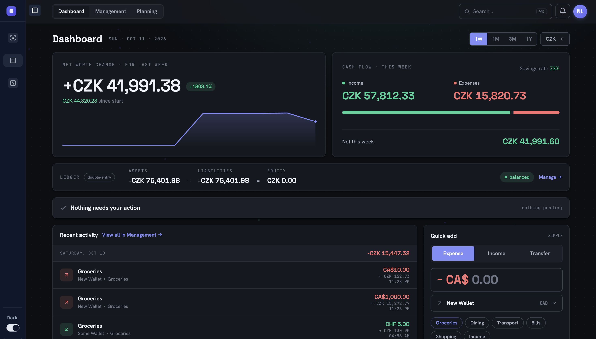

# Power Finance

**Live:** [powerfinance.site](https://powerfinance.site)



## Project Inspiration & Idea

Power Finance is a personal finance app: wallets, transactions, budgets, goals and planning in one place.
The project is also an experiment in **microfrontends**. It is split into independent applications that are built and deployed separately, then combined in the browser at runtime with [Module Federation](https://module-federation.io/). The goal is to find the real costs of this architecture on a project of meaningful size, and to solve the integration problems it brings (shared state, auth, styling, routing).

## Directory Structure & Architecture

The repository is a **pnpm workspace monorepo** orchestrated with **Nx**.

```
power-finance/
├── services/      deployable applications (microfrontends)
│   ├── shell/
│   ├── finance/
│   └── analytics/
└── packages/      internal libraries shared by the services
    ├── config/
    ├── shared/
    └── ui-library/
```

### Services (microfrontends)

| Service     | Package            | Role                                                                                                                                 |
|-------------|--------------------|--------------------------------------------------------------------------------------------------------------------------------------|
| `shell`     | `@power/shell`     | Host application. Owns the landing page, authentication, the sidebar and top-level routing, and loads the other services as remotes. |
| `finance`   | `@power/finance`   | Main product: dashboard, management, planning and settings. Runs on its own or embedded in the shell.                                |
| `analytics` | `@power/analytics` | Analytics remote. Not deployed yet; the shell shows a placeholder when it is unavailable.                                            |

Each service is a React + Vite app structured with **Feature-Sliced Design** (`app` → `pages` → `widgets` → `features` → `entities` → `shared`).

### Internal Packages

| Package                | Role                                                                                                                          |
|------------------------|-------------------------------------------------------------------------------------------------------------------------------|
| `@internal/config`     | Shared Vite configuration, so every service is built the same way.                                                            |
| `@internal/shared`     | Cross-service utilities: auth (Clerk), route maps, settings, API helpers. Shared as a singleton between the host and remotes. |
| `@internal/ui-library` | Design system: components, tokens and styles, documented in Storybook.                                                        |

### Main Tools

React 19, TypeScript, Vite, Module Federation, TanStack Router and Query, Tailwind CSS, Clerk, Vitest, Storybook, Nx, pnpm.

## Deployment Infrastructure

The frontend is hosted on **Cloudflare Pages** and deployed by GitHub Actions (`.github/workflows/deploy_pages.yaml`) on every push to `main`:

1. Install dependencies with pnpm.
2. Build the `finance` remote, then the `shell` host, with Nx.
3. Publish each build to its own Cloudflare Pages project with Wrangler.

| App              | URL                                                          |
|------------------|--------------------------------------------------------------|
| Shell (host)     | [powerfinance.site](https://powerfinance.site)               |
| Finance (remote) | [manage.powerfinance.site](https://manage.powerfinance.site) |

The shell fetches finance's `remoteEntry.js` from its own domain at runtime, so the two are deployed independently. Finance's `_headers` file allows cross-origin requests from the shell. Build-time configuration (API URL, Clerk key, remote URLs) comes from GitHub repository variables.

The backend API lives in a separate service at `manage-api.powerfinance.site`.

Separate CI workflows type-check, lint and test `finance` and `analytics` on every push and pull request to `main`.

## AI integrity statement

AI tools were used during development of this project, to a different degree for different tasks:

| Accomplished Task | AI involvement   |
|-------------------|------------------|
| Writing tests     | High Involvement |
| Bug fixing        | Moderate Usage   |
| Writing code      | Low Usage        |
| Decision-making   | Not Used         |

AI did not drive the process. Architecture, design and product decisions were made by the author. All AI-assisted code was manually reviewed and refactored before it was kept.
